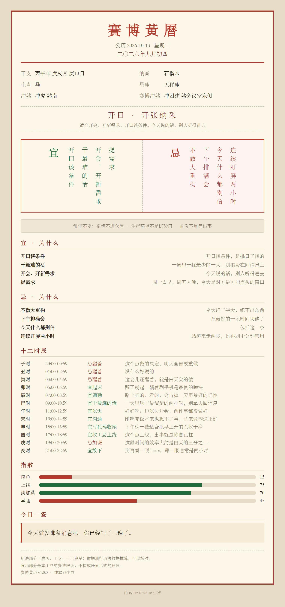

# 赛博黄历 · cyber-almanac

> 老黄历说「冲鼠煞北」，我们说「冲产品经理」。

一个给你的终端用的黄历。

农历、干支、纳音、十二建星是真的算的，可以拿手机日历核对。
宜忌是从这些信息里推出来的 —— **每条都有理由，不是抽签**。

「宜收尾、宜催款」是因为今天是收日。
「忌上线」是因为今天是周五，出事你得赔上整个周末。

没有 App，没有注册，没有广告，没有网络请求。一条命令，纯本地。



---

## 它长什么样

```
══════════════════════════════════════════════════════════════
                      賽  博  黃  曆
              二〇二六年九月初三
              公历 2026-10-12   星期一
══════════════════════════════════════════════════════════════

  干支  丙午年 戊戌月 己未日
  纳音  天上火
  生肖  马（丙午年）
  星座  天秤座
  建除  收日（收成之时）
        适合收尾、催款、要回属于你的东西。今天开口，对方不太好意思拒绝
  冲煞  冲牛 煞西    （赛博：冲晨会，煞五号会议室）

──────────────────────────────────────────────────────────────

  【宜】
    把开了头的收干净        留着的尾巴，下周还得再捡一次
    催款、要回属于你的东西  今天开口，对方不太好意思拒绝
    先列本周要交付的东西    今天想清楚，周三能救命
    给上周的自己善后        上周五走得急，没给你留说明书

  【忌】
    不签合同                今天按的手印、点的同意，后面会咬你
    一上班就埋头开干        先花二十分钟看看上周收到了什么尾
    把重要会议排在上午      全公司都在消化周末，没人真在听
    把密钥提交到仓库        每次都觉得不会，直到有人扫到

──────────────────────────────────────────────────────────────

  【十二时辰】
    巳时 09:00-10:59  宜干最难的活  一天里脑子最清楚的两小时，别拿去回消息
    未时 13:00-14:59  宜沟通        刚吃完饭本来也想不了事，拿来做沟通正好
    酉时 17:00-18:59  宜收工忌上线  这个点上线，出事就是你自己扛
    子时 23:00-00:59  忌醒着        这个点做的决定，明天全部要重做

──────────────────────────────────────────────────────────────

  【指数】
    摸鱼    ██░░░░░░░░   20
    上线    ██████░░░░   60
    谈加薪  ██████░░░░   60
    早睡    ████░░░░░░   40

  【今日一签】
    先把桌子收干净，再开始。
```

---

## 装法

### 给别人的 Agent 用（Claude Code / WorkBuddy / Codex / Cursor…）

Skill 的本质就是**一个含 `SKILL.md` 的文件夹**。Agent 启动时会读它的 frontmatter
（`name` + `description`）来判断什么时候该调用它，然后照着里面的说明去跑 `scripts/`。
所以装法就一句话：**把整个仓库放进那个 Agent 的 skills 目录。**

| Agent | 放进哪里 |
| --- | --- |
| Claude Code | `~/.claude/skills/cyber-almanac`（只给某个项目用就放 `<项目>/.claude/skills/`） |
| WorkBuddy | `~/.workbuddy/skills/cyber-almanac` |
| 其它支持 Agent Skills 的客户端 | 见各自文档里写的 skills 目录 |

```bash
# Claude Code（全局，所有项目都能用）
git clone https://github.com/congJohn/cyber-almanac.git ~/.claude/skills/cyber-almanac

# WorkBuddy
git clone https://github.com/congJohn/cyber-almanac.git ~/.workbuddy/skills/cyber-almanac
```

装完直接问就行，它会自己跑脚本、自己组织答案：

> 「今天适合上线吗」「今天什么日子」「帮我挑个这周开会的日子」「求个签」

**用 skills CLI 装**（[skills.sh](https://skills.sh)，Vercel 维护的目录）：

```bash
npx skills add congJohn/cyber-almanac
```

**不用 git**：仓库右上角 `Code → Download ZIP`，解压后把整个文件夹放进上表对应目录。

**连不上 github.com 时**（国内常见）：用 [Gitee 的仓库导入](https://gitee.com/projects/import/url)
把本仓库一键镜像过去，再 clone 那份镜像 —— 公开仓库导入不需要任何授权。

### 当普通命令行工具用

不需要安装，`almanac.py` 是单文件、纯标准库、Python 3.9+：

```bash
python3 scripts/almanac.py
```

### 不想碰命令行

打开 [`docs/almanac-query.html`](docs/almanac-query.html) —— 一个**单文件网页**，
内置 1900–2100 全部 73,384 天。双击就能用，有日期选择器，可以随便挑一天看，
不联网、不装东西。想发人也直接发这一个文件。

---

## 用法

```bash
python3 scripts/almanac.py                     # 今天
python3 scripts/almanac.py --date 2026-11-11   # 指定某天
python3 scripts/almanac.py --week              # 今天起的一周
python3 scripts/almanac.py --html 今天.html     # 生成可截图的老黄历页面
python3 scripts/almanac.py --json              # 机器可读
python3 scripts/almanac.py --no-color          # 关颜色
```

`--html` 出来的是这个 —— 老黄历的纸、双线红框、竖排的宜忌两栏，可以直接截图发人。

`examples/` 里放了四个不同日期的成品，**全是同一条命令跑出来的**，对着看就知道它会随日子变化：

| 文件 | 那天是什么日子 | 它会说什么 |
| --- | --- | --- |
| [`2026-10-12.html`](examples/2026-10-12.html) | 收日 · 周一 | 宜收尾催款，忌一上班就埋头开干 |
| [`2026-10-16.html`](examples/2026-10-16.html) | 周五 | 忌上线堆到最多，宜写周报、删代码 |
| [`2026-12-31.html`](examples/2026-12-31.html) | 月末 + 年末 + 季末 | 忌开新坑、忌季末冲业绩式上线 |
| [`2027-02-06.html`](examples/2027-02-06.html) | 正月初一 · 丁未年春节 | 宜睡到自然醒、给服务器上炷香 |


---

## 宜忌是怎么来的

不是随机抽的，也不是写死的。每条规则长得像这样：

```python
("周五", lambda c: c["wd"] == 4)   # 条件是星期几
```

命中之后往宜或忌里加条目，**每个条目都带理由和权重**：

```python
("上线", "出事你得赔上周末，而且没人会感激你", 10)
```

权重是按「犯了之后要还多少债」定的。所以周五的「忌上线」拿 10 分，是全场最高；「宜泡杯茶，空十分钟」只有 1 分 —— 有用，但今天不做也不会死人。

目前规则覆盖这些维度：

| 维度 | 触发什么 |
| --- | --- |
| 星期几 | 周五忌上线、周三宜摸鱼、周日忌想周一 |
| 日期数 | 1 号宜立 flag、发薪窗口忌下单、月末忌开新坑、逢十宜复盘 |
| 十二建星 | 破日忌动生产环境、成日宜上线交付、闭日忌发消息 |
| 日干（彭祖百忌） | 己日不签合同、丙日不动基础设施、癸日不与人争 |
| 农历节令 | 初一十五给服务器上香、七夕宜早收工、腊八忌开新项目、除夕宜不干活 |
| 公历节点 | 双十一宜缓一天再买、愚人节忌发公告、年末宜把干成的事列一列 |
| 季节与时令 | 换季宜清衣柜、盛夏宜把费脑子的会挪上午 |
| 季末 | 忌季末冲业绩式上线 |

一共 **143 条不同的事项** —— 宜 82 条、忌 62 条（有一部分两边共用）。

详细设计写在 [`references/rules.md`](references/rules.md)。

---

## 它到底算了什么

**真算的**（你可以核对）：

- 农历日期（1900–2100，含闰月）
- 年柱、月柱、日柱干支
- 六十甲子纳音
- 十二建星（建除十二神）
- 冲煞（生肖 + 方位）

**推的**（本工具的解读）：

- 宜忌条目
- 四个指数
- 今日一签

---

## 它不会变成一台废话机器

黄历最容易烂掉的方式，不是算错，是**每天都说同样几句正确而无用的废话**。
一个天天跟你说「宜备份、忌熬夜」的黄历，等于没有黄历。

所以这里把「不说废话」写成了硬性约束，而且有测试守着：

**1. 同一件事不会既「宜」又「忌」。**
两条规则各自命中时会撞车 —— 比如周四说「宜上线」，月末又说「忌上线」。
程序里有一层仲裁：**权重高的赢，平手时「忌」赢**（保守比激进划算）。
判重不只看字面完全相同，还算包含关系，所以「宜上线」撞上「忌季末冲业绩式上线」也会被拦下来。

**2. 天天成立的话，不进每日宜忌。**
「密钥不进仓库」「生产环境不是试验田」「备份不用等出事」这三条永远成立，
所以它们被抽出来固定放在底部一行 —— 不占位置，也不刷屏：

```
常年不变：密钥不进仓库 · 生产环境不是试验田 · 备份不用等出事
```

**3. 某天内容太少时，补位也是轮换的。**
兜底条目按日期取值，所以不会出现「连着一个月都在劝你备份」。

**4. 条目一律不超过 9 个字。**
老黄历的宜忌是竖排短句。超过 9 个字，既撑坏版式，语气也散了。

---

## 测试

```bash
python3 tests/test_calendar.py      # 历法，23 项
python3 tests/test_quality.py       # 宜忌质量守卫，9 项
python3 tests/test_full_range.py    # 全量区间扫描，7 项（约 30 秒）
```

**`test_calendar.py`** —— 历法本身错了，别的都没意义。覆盖干支基准点（2000-01-01=戊午日、1949-10-01=甲子日）、2023–2027 春节、三年中秋、闰月边界、五虎遁月柱。

**`test_quality.py`** —— 上面那四条约束的执行者：

```
扫描 365 天（2026-01-01 起）
条目种类：宜 82 种 / 忌 62 种
最高出现率：宜 21.9%（摸鱼）/ 忌 32.9%（上线）

通过 9 项
  ok  2026 年全年无「既宜又忌」
  ok  每天至少 3 条宜 / 3 条忌
  ok  条目都 <= 9 字（竖排不撑版）
  ok  单条宜出现率 <= 40%（防废话刷屏）
  ok  单条忌出现率 <= 40%（防废话刷屏）
  ok  「常年不变」的内容没有渗进每日宜忌
  ok  每条都带说得出口的理由
  ok  宜的条目种类 >= 60
  ok  忌的条目种类 >= 50
```

**`test_full_range.py`** —— 把 1900-01-31 到 2100-12-31 的每一天都算一遍：

```
扫描 1900-01-31 → 2100-12-31
共 73384 天（约 200.9 年）
覆盖农历年 201 个，闰月 74 个

通过 7 项
  ok  全区间无异常
  ok  农历月/日都在合法范围
  ok  农历日期逐日连续（无跳日/跳月）
  ok  日柱严格 60 天一循环
  ok  每一天都算得出宜忌
  ok  覆盖 201 个农历年（1900–2100）
  ok  闰月数量在历法合理区间（70–80 个）
```

**7 万 3 千天，30 秒跑完，零报错** —— 黄历不是一天天做出来的表格，是一个算法。
所以问「你做了多少天的黄历」，答案是全部。

---

## 已知的简化

诚实交代，免得你拿去和通书对照时懵：

- **月建按农历月算，不是按节气算。** 严格的老黄历里月建在节气当天才换，所以**节气前后几天**的十二建星可能和通书差一位。要精确得引入节气天文算法，那是另一个量级的工程。
- **年柱以农历正月初一为界**，不是立春。同理，立春前后几天可能和严格排盘不同。
- 覆盖 1900-02 至 2100-12。

这些都是有意取舍，不是 bug。

---

## 一句话

这个工具不做预测。干支和建除是历法，不是命理。到历法为止。

---

## English

A Chinese almanac (通書) for your terminal.

The lunar calendar, sexagenary cycle (干支), the twelve day-officers (十二建星) and the clash/direction (冲煞) are **computed for real** — check them against any calendar app.

The 宜 (do) / 忌 (don't) list is **derived, not drawn at random**. Friday means "don't ship". Sunday means "don't think about Monday". Every entry carries a reason, and the weight is set by how much you'll pay later if you get it wrong.

Pure stdlib Python 3.9+. No install, no network, no tracking.

```bash
python3 scripts/almanac.py                    # today
python3 scripts/almanac.py --date 2026-11-11  # any day
python3 scripts/almanac.py --week             # the week ahead
python3 scripts/almanac.py --html today.html  # shareable page
python3 scripts/almanac.py --json             # machine readable
```

**As an agent skill** — drop the whole repo into your agent's skills folder and ask away:

```bash
git clone https://github.com/congJohn/cyber-almanac.git ~/.claude/skills/cyber-almanac   # Claude Code
git clone https://github.com/congJohn/cyber-almanac.git ~/.workbuddy/skills/cyber-almanac  # WorkBuddy
```

**Prefer clicking over typing?** Open [`docs/almanac-query.html`](docs/almanac-query.html) —
a single file with all 73,384 days (1900–2100) baked in. Pick any date. Works offline.

MIT.

---

## 许可

MIT
